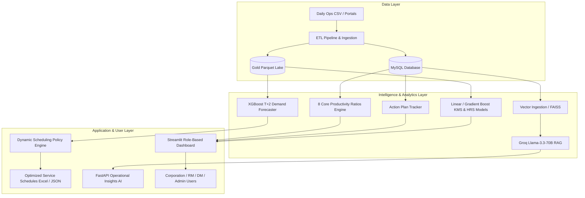

# TGSRTC AI Operations & Dynamic Scheduling Platform

An enterprise-grade AI, Analytics, and Dynamic Scheduling platform built for the **Telangana State Road Transport Corporation (TGSRTC)**. This system unifies multi-tier operational dashboards, real-time KPI ratio monitoring, automated machine learning forecasts, an AI-powered RAG assistant, and an automated T+2 dynamic bus scheduling engine.

---

## 📌 Table of Contents
- [System Architecture](#-system-architecture)
- [Key Features](#-key-features)
  - [1. Role-Based Portals (Corporation, RM, DM, Admin)](#1-role-based-portals)
  - [2. Operational Analytics & The 8 Core Ratios](#2-operational-analytics--the-8-core-ratios)
  - [3. AI Dynamic Scheduling Engine](#3-ai-dynamic-scheduling-engine)
  - [4. RAG-Powered Conversational AI](#4-rag-powered-conversational-ai)
  - [5. Machine Learning & Forecasting Models](#5-machine-learning--forecasting-models)
  - [6. Security & Defense-in-Depth](#6-security--defense-in-depth)
- [Project Structure](#-project-structure)
- [Tech Stack](#-tech-stack)
- [Installation & Setup](#-installation--setup)
- [Configuration](#-configuration)
- [Running the Services](#-running-the-services)
- [Database Schema & Migration](#-database-schema--migration)

---

## 🏛 System Architecture



---

## 🚀 Key Features

### 1. Role-Based Portals
Multi-tenant architecture serving distinct organizational tiers with tailored access control:
- **Corporation Level (`Input_Data_tgsrtc.py`, `Action_plan_tgsrtc.py`, `Ratios_tgsrtc.py`)**: State-wide aggregation, macro KPIs, inter-regional comparisons.
- **Regional Manager (RM) (`Input_Data_RM.py`, `depot_dashboard_rm.py`, `driver_dashboard_RM.py`)**: Cross-depot regional supervision, performance anomalies, and resource allocation.
- **Depot Manager (DM) (`Input_Data_DM.py`, `depot_dashboard_dm.py`, `driver_dashboard_DM.py`)**: Daily vehicle and crew log entries, variance reports, and daily action planning.
- **Administrator (`admin.py`, `app_ui_admin.py`)**: User provisioning, role assignment, depot association, and access logs.

### 2. Operational Analytics & The 8 Core Ratios
Tracks operational health across key labor and fleet efficiency indices against Rural/Urban benchmarks:
- **Driver Schedule Ratio**: Target 2.18 (Rural) / 2.43 (Urban).
- **Weekly Off / National Off (%)**: Benchmark 14.0%.
- **Special Off (%)**: Night out / Inter-city allowance.
- **Spot Absenteeism & Long Leave (%)**: Real-time crew availability metrics.
- **Double Duty (%)** & **Off Cancellation (%)**: Driver workload balancing.
- **Fleet Utilization & Service Cut Analytics**: Analysis of canceled vs. planned trips (`krmr_cut_services_analysis.py`).

### 3. AI Dynamic Scheduling Engine
Located in `dynamic_scheduling_master/`:
- **Stage 1 (Data Ingestion)**: Ingests raw depot and service CSVs, validates bounds, joins with holiday and Telugu festival calendars, and creates the GOLD Parquet layer.
- **Stage 2 (Demand Prediction)**: Trains an **XGBoost** model incorporating weather, calendar cycles, and historical lag features to forecast demand at T+2 days.
- **Stage 3 (Supply Scheduling)**: Executes policy-driven adjustments:
  - *Delta-KMs Engine*: Adjusts trip frequencies to optimize fuel and vehicle wear.
  - *EPK/OR Engine*: Uses Earnings Per Kilometer thresholds to cut unprofitable runs and add high-yield services.

### 4. RAG-Powered Conversational AI
- **FastAPI Engine (`app.py`)**: High-throughput REST API for querying operational intelligence.
- **Vector Search (`retriever.py`, `build_faiss_index.py`)**: Built on FAISS and Sentence-Transformers to retrieve depot data and operational guidelines.
- **LLM Reasoning**: Leverages **Groq** (`llama-3.3-70b-versatile`, `qwen/qwen3-32b`, `llama-3.1-8b-instant`) with domain-specific system prompts.

### 5. Machine Learning & Forecasting Models
- **KMs and Hours Forecaster (`kms_hrs.py`, `train_kms_hrs.py`)**: Predicts expected service kilometers and steering hours.
- **Operational Data Regression (`models_kms_hrs/`, `forecast.py`)**: Machine learning models predicting vehicle operational demands.

### 6. Security & Defense-in-Depth
- **Authentication & Auditing (`auth.py`)**: Salting and password hashing via **Bcrypt**, PBKDF2 fallback, and account lockout after repeated failed attempts.
- **Anti-Bot & Automation (`captcha_utils.py`)**: Visual CAPTCHA generation with EasyOCR / OpenCV validation.
- **HTTP Hardening (`security_headers.py`, `nginx_security.conf`)**: Enforces strict CSP, X-Frame-Options, HSTS, and rate-limiting rules.

---

## 📂 Project Structure

```
server/
├── app.py                             # FastAPI service for Groq LLM & RAG queries
├── login.py                           # Main Streamlit web dashboard entry point
├── auth.py                            # Authentication, session manager & password security
├── db_config.py                       # SQLAlchemy engine & MySQL connection pooling
├── config.json                        # Database, application & path configuration
├── requirements.txt                   # Complete Python dependencies
│
├── dynamic_scheduling_master/         # AI-driven T+2 Dynamic Bus Scheduling System
│   ├── app.py                         # Dynamic Scheduling Streamlit UI
│   ├── src/dynamic_scheduling/        # Core pipeline: Ingest -> Predict -> Schedule
│   ├── data/                          # Master data, calendars, raw & gold parquets
│   └── model/                         # Trained XGBoost models & hyperparameters
│
├── Action_plan_*.py                   # DM, RM, and Corporation action plan modules
├── Input_Data_*.py                    # Multi-tier daily operational data forms
├── Ratios_*.py / eight_ratios_*.py    # 8 Core Operational Ratios computation
├── depot_dashboard_*.py               # Depot performance dashboards
├── driver_dashboard_*.py              # Driver crew utilization dashboards
│
├── Etl_main.py                        # Daily operational ETL processing
├── build_faiss_index.py               # Vector database creation script
├── create_rag_documents.py            # Preprocesses operational data for RAG
├── retriever.py                       # FAISS vector similarity retriever
├── captcha_utils.py                   # CAPTCHA generation and validation
├── security_headers.py                # HTTP security middleware headers
└── nginx_security.conf                # Nginx reverse proxy hardening configuration
```

---

## 🛠 Tech Stack

| Domain | Technologies |
|---|---|
| **Web Dashboard** | Streamlit, Streamlit-AgGrid, Altair, Plotly |
| **API Backend** | FastAPI, Uvicorn, Pydantic |
| **Database & ORM** | MySQL, SQLAlchemy, PyMySQL, mysql-connector-python |
| **Machine Learning** | XGBoost, Scikit-Learn, Joblib, Pandas, NumPy |
| **AI / RAG / LLM** | Groq API (Llama 3.3 70B), FAISS, Sentence Transformers |
| **Security & Vision** | Bcrypt, OpenCV, EasyOCR, Playwright, BeautifulSoup4 |

---

## ⚡ Installation & Setup

### 1. Prerequisites
- **Python 3.10+** (Python 3.11 recommended)
- **MySQL Server 8.0+**
- **Git**

### 2. Clone the Repository
```bash
git clone https://github.com/GandamallaPradyumn/server---Copy--2-.git
cd server---Copy--2-
```

### 3. Create a Virtual Environment
```powershell
python -m venv .venv
# On Windows:
.venv\Scripts\activate
# On Linux/macOS:
source .venv/bin/activate
```

### 4. Install Dependencies
```bash
pip install -r requirements.txt
```

---

## ⚙️ Configuration

Create or verify `config.json` in the root directory:

```json
{
  "db": {
    "host": "localhost",
    "user": "root",
    "password": "YOUR_MYSQL_PASSWORD",
    "database": "tgsrtc_new"
  },
  "logo_path": "LOGO.png"
}
```

### Environment Variables
For the RAG and LLM API service, export your Groq API key:

```powershell
# Windows PowerShell
$env:GROQ_API_KEY="your-groq-api-key"

# Linux / Bash
export GROQ_API_KEY="your-groq-api-key"
```

---

## 🚀 Running the Services

### 1. Launch the Main Streamlit Dashboard
```bash
streamlit run login.py
```
Access the dashboard at `http://localhost:8501`.

### 2. Launch the AI RAG & Insights API
```bash
uvicorn app:app --host 0.0.0.0 --port 8000 --reload
```
Interactive Swagger API docs will be available at `http://localhost:8000/docs`.

### 3. Rebuild FAISS Vector Index (Optional)
When new depot metrics or operational manuals are added:
```bash
python create_rag_documents.py
python build_faiss_index.py
```

---

## 🔒 Security Best Practices
- Keep your production database passwords and `GROQ_API_KEY` in environment variables.
- Large datasets (`.csv`, `.zip`, `.parquet`) are excluded via `.gitignore` to prevent repository bloat and ensure sensitive operational records remain protected.
